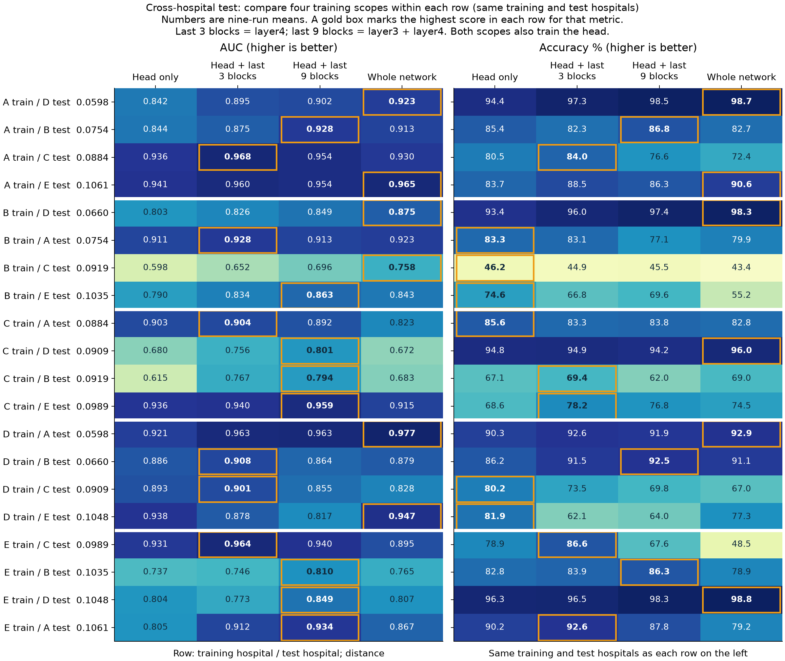
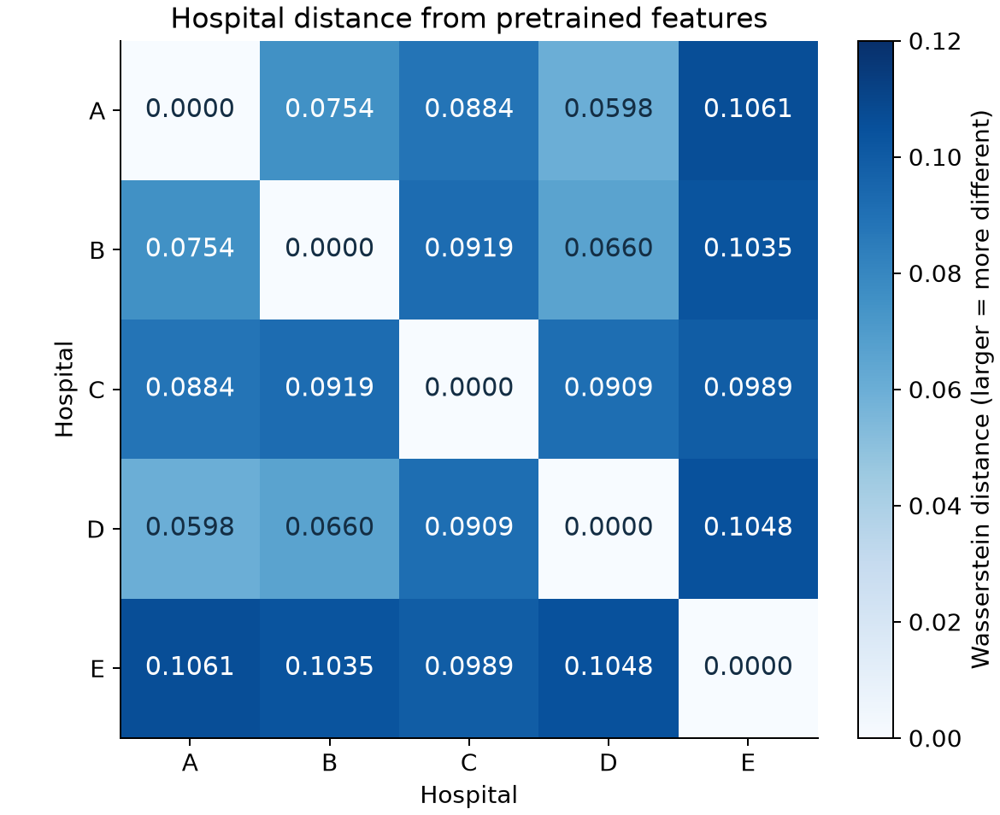
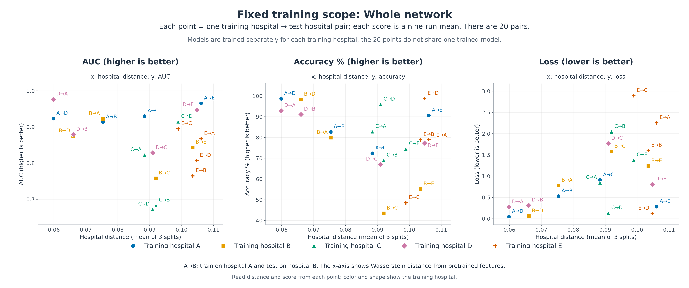
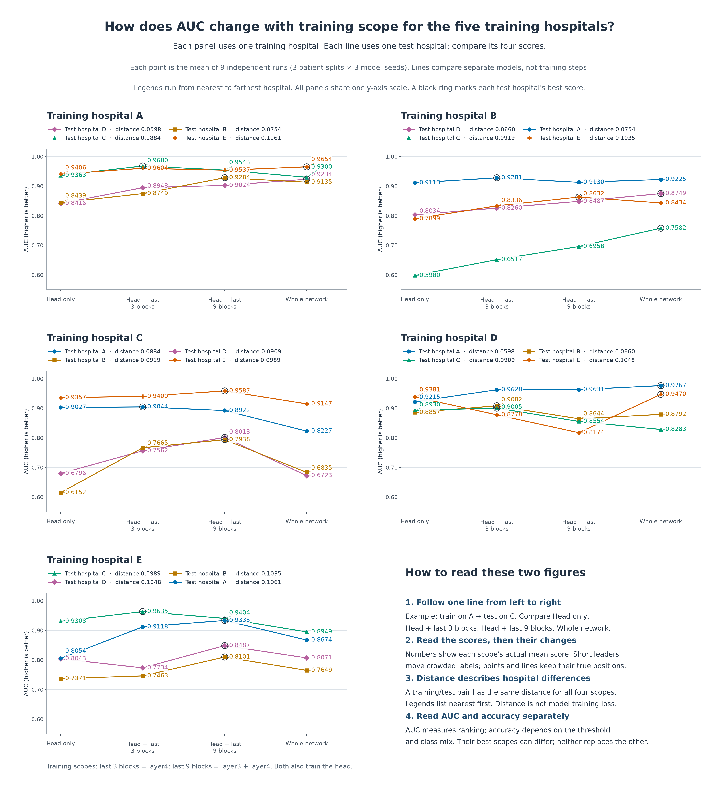
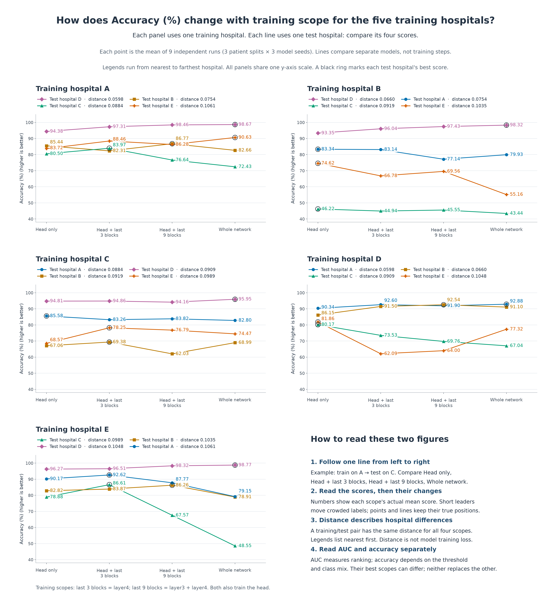

# Camelyon17 project: what did we do, and what do the results tell us?

**Group 12 · Zhang · 22 October 2026**

This report is for our group members. We first explain how training and testing worked, then answer the questions in the proposal. All experiment numbers come from the saved results of these experiments.

## 1. What experiments did we actually run?

### What data did we use, and what did the model learn to do?

We used an ImageNet-pretrained ResNet-50 to predict whether the centre of a small tissue image contains a tumour. The dataset has **455,954 small images from 43 patients, 50 slides and 5 hospitals**. We call the five hospitals A, B, C, D and E below.

Each patient provides many images. We split the patients first, then put all images from each patient into that patient's assigned set. This prevents any patient from appearing in both training and testing.

| Hospital | Training patients | Validation patients | Test patients | Total patients |
|---|---:|---:|---:|---:|
| A | 4 | 1 | 2 | 7 |
| B | 5 | 2 | 1 | 8 |
| C | 5 | 2 | 2 | 9 |
| D | 6 | 2 | 2 | 10 |
| E | 5 | 2 | 2 | 9 |

This is our own patient split for this project, rather than the official WILDS benchmark split. All scores below come from this experiment setup.

The three sets have different roles: **the training set updates the model; the validation set decides which epoch's model to keep; the test set scores the saved model.** “Using the full dataset” means that every image was assigned to one of these three sets. It does not mean that test images were used for training.

### How do the four training methods differ?

We compare which parts of the network can update their parameters when training on data from the same hospital. “Frozen” means that the parameters stay unchanged; “unfrozen” means that they can update during training.

| Name used in this report | Which parts actually update? |
|---|---|
| Head only | Only the final classification layer, which predicts whether a tumour is present, updates. The earlier network stays unchanged. |
| Head + last 3 blocks | The classification head and `layer4` update. `layer4` contains 3 residual blocks. |
| Head + last 9 blocks | The classification head, `layer3` and `layer4` update. These last two parts contain 9 residual blocks in total. |
| Whole network | The classification head and all earlier parts of the network update. |

**There is a difference from the proposal here: the proposal says the last 1 and last 2 blocks, but the actual code trains the last 3 and last 9 blocks.** This report describes the experiments we actually ran. Renaming them 1 / 2 would not mean that we had completed those two original settings.

### Using A as an example, how did training and testing work?

1. We used only **A's training set** to train each of the four models above. The four methods used the same patient lists and training settings. The main difference was which parameters could update.
2. After every training epoch, we calculated loss on **A's validation set**. We kept the model from the epoch with the lowest validation loss.
3. After training, we tested each saved model on **the test sets of A, B, C, D and E**, without updating it again.

Training on A and testing on new patients from A is **same-hospital testing (IN / ID)**. Training on A and testing on B–E is **cross-hospital testing (OUT / OOD)**. **IN is also a test score, rather than a score on the training images.** Images from B–E were not used to train these A models or to select which epoch to keep.

We then changed the training hospital to B and repeated the process; we did the same for C, D and E. Each run started again from the original ImageNet-pretrained weights. We did not continue training A's model on B.

### Why were there 180 training runs?

We made three different patient lists to check whether changing the training, validation and test patients would change the results. For each fixed list, we also trained each model independently three times. These three runs changed the randomness during training, such as image order and the initial parameters of the new classification head.

So, **5 training hospitals × 4 training methods × 3 patient lists × 3 independent training runs = 180 models**. Each model was tested on five hospitals, giving **900 sets of test results**. All of this training and testing is complete.

For example, “train on A, test on B, Head only” has nine scores: three patient lists, with three training runs for each list. The hospital-pair scores below are the averages of these nine runs. The three lists still come from the same 43 patients; they are not three new groups of patients.

### What do AUC, accuracy and loss tell us?

The model first gives each image a probability of containing a tumour, then uses it to predict whether a tumour is present. We check its performance from three angles:

| Metric | What does it ask? | What is better? |
|---|---|---|
| Accuracy | With a probability threshold of 0.5, how many images does the model classify correctly? | Higher is better. 82% means that about 82% of images are classified correctly. |
| AUC | When comparing one tumour image and one non-tumour image, does the model usually give the tumour image a higher score? | Higher is better. It checks how the scores rank the two classes, rather than the proportion of correct answers. |
| Loss | How far are the predicted probabilities from the correct answers? A very confident wrong answer receives a larger penalty. | Lower is better. |

A high AUC therefore does not guarantee high accuracy at the 0.5 threshold. When the two metrics choose different winners below, we need to explain them separately rather than combine them into “this model is best”.

## 2. Which of the four training methods scored best? — Proposal item 1

### First compare cross-hospital testing

Here we fix the test setting: **all models are tested on other hospitals. We compare the average scores of the four training methods.** Each of the five hospitals is used for training and tested on the other four, giving 20 cross-hospital tasks. Each task has equal weight in the average. A hospital does not receive more weight because it has more images.

| Training method | Mean cross-hospital AUC | Mean cross-hospital accuracy |
|---|---:|---:|
| Head only | 0.8357 | 82.21% |
| Head + last 3 blocks | 0.8674 | **82.40%** |
| Head + last 9 blocks | **0.8769** | 80.64% |
| Whole network | 0.8595 | 78.86% |

Read down one column to compare the methods. Bold only marks the highest value in that column.

- **For cross-hospital AUC, Head + last 9 blocks ranks first.** Its AUC is 0.8769, which is 0.0174 higher than the Whole network score of 0.8595.
- **For cross-hospital accuracy, Head + last 3 blocks ranks first.** Its accuracy is 82.40%, which is 3.54 percentage points higher than Whole network. However, it is only 0.19 percentage points higher than Head only at 82.21%, so that gap is very small.

In this experiment, Head only did not have the highest cross-hospital AUC. Among the four methods, **the last 9 blocks rank first by AUC and the last 3 blocks rank first by accuracy; both methods also train the classification head.**

### Then compare same-hospital testing

Now we change the setting: **we compare only the five same-hospital tasks, such as training on A and testing on A, or training on B and testing on B.** We still compare the four training methods within each column.

| Training method | Mean same-hospital AUC | Mean same-hospital accuracy |
|---|---:|---:|
| Head only | 0.8962 | 82.70% |
| Head + last 3 blocks | 0.9114 | 82.67% |
| Head + last 9 blocks | 0.9075 | 81.15% |
| Whole network | **0.9433** | **83.55%** |

**For same-hospital testing, Whole network ranks first in both mean AUC and mean accuracy. For cross-hospital testing, the two winners change to the last 9 and last 3 blocks, respectively.** This is the difference we observed: the training method that ranks first on new patients from the training hospital may no longer rank first at other hospitals.

This does not say that unfreezing the last few blocks makes cross-hospital scores higher than same-hospital scores. For example, Head + last 9 blocks has a same-hospital AUC of **0.9075** and a cross-hospital AUC of **0.8769**. Its cross-hospital AUC is still lower.

### If we also look at loss, is the winner the same?

We still use all 20 cross-hospital tasks, but now compare only the loss defined in Section 1.

| Training method | Mean cross-hospital loss |
|---|---:|
| Head only | 0.5482 |
| Head + last 3 blocks | 0.7971 |
| Head + last 9 blocks | 1.0566 |
| Whole network | 0.9947 |

The lowest value here is **0.5482** for Head only. In the earlier tables, the last 9 blocks had the highest AUC and the last 3 blocks had the highest accuracy. The three metrics therefore choose different winners. Whenever this report says “best”, it must also say which metric is being compared.

## 3. If we keep the training hospital fixed and change only the test hospital, does the winner change? — Proposal item 2

This time we do not average all hospitals together. **We first fix A as the training hospital, then compare the AUC of the four models within each test hospital.**

| Where are the models trained on A tested? | Head only | Head + last 3 blocks | Head + last 9 blocks | Whole network |
|---|---:|---:|---:|---:|
| Hospital B | 0.8439 | 0.8749 | **0.9284** | 0.9135 |
| Hospital C | 0.9363 | **0.9680** | 0.9543 | 0.9300 |
| Hospital D | 0.8416 | 0.8948 | 0.9024 | **0.9234** |
| Hospital E | 0.9406 | 0.9604 | 0.9537 | **0.9654** |

Read across one row to compare the four A models on the same hospital. In the B row, the last 9 blocks score highest; in the C row, the last 3 blocks score highest; in the D and E rows, Whole network scores highest.

**So the AUC winner does change when the test hospital changes.** “The last 9 blocks have the highest overall mean AUC” does not mean that they score highest at every hospital.

The figure below puts all 20 cross-hospital tasks together. Each row fixes the training hospital and test hospital, then compares the four training methods. The left half shows AUC and the right half shows accuracy. A gold box marks the winner for that row and metric. We explain the distance in the row labels in the next section.

Counting the gold boxes in each column on the left gives the number of tasks won by nine-run mean AUC: the last 9 blocks rank first in **8 tasks**, the last 3 blocks in **6 tasks**, Whole network in **6 tasks**, and Head only in **0 tasks**. No method wins every task. [All hospital results](All_Hospital_Results_EN.md).

## 4. Does a larger distance between hospitals mean worse model scores? — Proposal item 3

### First, what is distance?

Here, distance is not the geographical distance between two hospitals. We use the same fixed ImageNet-pretrained model to turn images from each hospital's training set into features, then compare the feature distributions. Specifically, the model outputs 2,048 feature values per image. We calculate a one-dimensional Wasserstein distance separately for each feature, then average the 2,048 distances.

**A larger number means that the two hospitals' image features differ more according to this method.** We compare the features one at a time and average the results; we do not measure how all 2,048 features vary together. This distance is not the model's error rate.

The reference model stays unchanged. Within the same patient split, each hospital pair therefore has one fixed distance. It does not change when we unfreeze more blocks in the classification model. The matrix below shows the average distances across the three patient splits. Row A, column C gives the distance between A and C. Swapping the row and column gives the same value.

### First fix training on A with Whole network, and compare the four test hospitals

Here we compare **how the same training method scores on test hospitals with different distances**. We are not yet comparing which of the four methods ranks first.

Below are the Whole network results for training on A, with test hospitals ordered from smallest to largest distance:

| Test hospital | Distance from A | AUC | Accuracy | Loss |
|---|---:|---:|---:|---:|
| D | 0.05984 | 0.9234 | 98.67% | 0.0483 |
| B | 0.07537 | 0.9135 | 82.66% | 0.5315 |
| C | 0.08839 | 0.9300 | 72.43% | 0.9091 |
| E | 0.10608 | 0.9654 | 90.63% | 0.2833 |

First look at accuracy: from D to B to C, distance increases and accuracy falls from 98.67% to 82.66% to 72.43%. At the most distant hospital, E, accuracy rises again to 90.63%. So, **across these four test hospitals, accuracy does not keep falling as distance increases.**

Now look at AUC: E, the most distant hospital, scores 0.9654, higher than D, the nearest, at 0.9234. But E has lower accuracy and higher loss. So, **in this same nearest-versus-farthest comparison, AUC, accuracy and loss do not all improve or all worsen together.**

### What about the other freezing methods in the same comparison of A's nearest hospital D and farthest hospital E?

We now keep these two test hospitals and check each of the four training methods. The distance from A to D is 0.05984, and from A to E is 0.10608. Each pair of rows below uses one training method, first tested on D, then on E.

| Fixed training method | Test hospital | AUC | Accuracy | Loss |
|---|---:|---:|---:|---:|
| Head only | D | 0.8416 | 94.38% | 0.1534 |
| Head only | E | 0.9406 | 83.72% | 0.3664 |
| Head + last 3 blocks | D | 0.8948 | 97.31% | 0.0816 |
| Head + last 3 blocks | E | 0.9604 | 88.46% | 0.4226 |
| Head + last 9 blocks | D | 0.9024 | 98.46% | 0.0536 |
| Head + last 9 blocks | E | 0.9537 | 86.28% | 0.4434 |
| Whole network | D | 0.9234 | 98.67% | 0.0483 |
| Whole network | E | 0.9654 | 90.63% | 0.2833 |

Compare each pair of rows: for all four methods, **E has higher AUC, lower accuracy and higher loss than D**. For example, with Head only, AUC rises from 0.8416 to 0.9406, but accuracy falls from 94.38% to 83.72%.

So, for this specific comparison of **training on A and testing on D versus E**, “the more distant hospital scores worse” cannot describe all three metrics. This table only describes this comparison; it cannot represent all training hospitals.

### What do we see when we include all 20 cross-hospital combinations?

Below, we fix the method to Whole network and keep all 20 combinations. Each point is one training-hospital and test-hospital pair. Farther right means a larger distance; the vertical axes show AUC, accuracy and loss. Models are trained separately for different training hospitals. The 20 points do not all share one model.

Near distance 0.10608 on the right, the figure includes both A→E and E→A. They have the same distance, but their AUC values are **0.9654 and 0.8674**, and their accuracies are **90.63% and 79.15%**, respectively. This shows that **even at the same distance, scores can differ when we swap which hospital is used for training and which for testing.**

These tables and figures give us the following observations: A's four-target table does not show all metrics falling in order as distance increases; in A's D/E comparison, AUC and accuracy move in different directions for all four training methods; and in the figure with all combinations, the same distance can correspond to different scores. **So, at present, we cannot directly use the size of the distance to predict how well a model will score at a test hospital.** These observations do not prove that distance and performance are completely unrelated. We have also not separated the effects of patient composition, class proportions and other factors.

All 20 combinations for the other three training methods are in the [full hospital results](All_Hospital_Results_EN.md). Section 5 shows how AUC and accuracy change across the four methods. In Section 6, we use the actual scores from each training hospital to check whether the same patterns appear.

## 5. Once we know the distance, can we choose the best training scope? — The proposal's main question

We look at this in three steps: **first, how the four models' scores change when we change which parts are frozen; then, whether these changes are the same across training hospitals; and only then, whether distance can help us choose.**

### 5.1 First look at AUC: for the same hospital pair, how does the score change when we change which parts are frozen?

In each comparison, **the training hospital, test hospital and patient list are the same. We change only which parts are allowed to update their parameters**. From left to right, the four methods are:

1. Train only the classification head; freeze all earlier parts of the network.
2. Train the head + last 3 blocks; freeze the remaining earlier parts.
3. Train the head + last 9 blocks; freeze the remaining earlier parts.
4. Train the whole network; all parts can update.

So, from left to right, **more of the network is unfrozen and less stays frozen**. Each of the four models starts training from the pretrained weights. We do not train the head first and then gradually unfreeze the same model. Every score below averages three patient lists, with three training runs per list.

**First look at the figure: each panel fixes one training hospital, and each line fixes one test hospital. Follow one line to see how its four scores change.** The circled point is that line's highest AUC. The legend gives the test hospital and its distance.

Remember, **the horizontal axis is training scope, rather than distance**. For example, along the line for training on A and testing on B, distance stays at 0.07537 from left to right. What changes is the model's training scope and its resulting AUC. Distance comes from the fixed reference model; it does not take a new value when we unfreeze a few more blocks.

The figure includes all 20 cross-hospital combinations. To explain how to read it, the table below selects one example per training hospital. Read across a row to compare the four models for that combination.

| Train → Test | Distance | Head only | Head + last 3 blocks | Head + last 9 blocks | Whole network |
|---|---:|---:|---:|---:|---:|
| A→B | 0.07537 | 0.8439 | 0.8749 | **0.9284** | 0.9135 |
| B→C | 0.09193 | 0.5980 | 0.6517 | 0.6958 | **0.7582** |
| C→B | 0.09193 | 0.6152 | 0.7665 | **0.7938** | 0.6835 |
| D→E | 0.10475 | 0.9381 | 0.8778 | 0.8174 | **0.9470** |
| E→C | 0.09891 | 0.9308 | **0.9635** | 0.9404 | 0.8949 |

The changes differ from row to row:

- **Train on A, test on B:** 0.8439 → 0.8749 → 0.9284 → 0.9135. Unfreezing the last 3 blocks raises AUC by 0.0310; extending this to the last 9 raises it by another 0.0535; extending it to the whole network lowers it by 0.0150. For this pair, the last 9 blocks score best.
- **Train on B, test on C:** 0.5980 → 0.6517 → 0.6958 → 0.7582. Across the four methods, mean AUC rises as the training scope grows. Whole network scores best.
- **Train on C, test on B:** 0.6152 → 0.7665 → 0.7938 → 0.6835. AUC peaks at the last 9 blocks, then drops clearly with Whole network. Although the distance between B and C stays the same, reversing training and testing gives a different choice.
- **Train on D, test on E:** 0.9381 → 0.8778 → 0.8174 → 0.9470. AUC first falls as the training scope grows, then rises with Whole network. So we cannot assume that the four methods must get steadily better or steadily worse.
- **Train on E, test on C:** 0.9308 → 0.9635 → 0.9404 → 0.8949. The last 3 blocks score highest; expanding the training scope further lowers AUC.

The differences here were calculated from the original unrounded means, then rounded to four decimal places. **The current data show that changing which parts are frozen does change AUC, but the direction of the change differs across training and test hospitals.** This has not yet answered whether distance can choose the training scope. We check that separately below.

### 5.2 If we look at accuracy, are the changes the same?

We now keep the same 20 combinations and four training methods, but change the metric to accuracy. Each point is a percentage. Each line still represents a fixed training hospital and test hospital.

Take the same **train-on-B, test-on-C** example:

| Training scope | AUC | Accuracy |
|---|---:|---:|
| Head only | 0.5980 | **46.22%** |
| Head + last 3 blocks | 0.6517 | 44.94% |
| Head + last 9 blocks | 0.6958 | 45.55% |
| Whole network | **0.7582** | 43.44% |

For this pair, Whole network has the highest AUC but the lowest accuracy. AUC checks the score ranking of the two classes; accuracy checks the final answers at the 0.5 threshold. The two may not improve together.

So, **we must choose the winner by AUC and the winner by accuracy separately.** The two figures above show these scores separately, rather than combining them into one “best model”. The AUC, accuracy and loss values for all 20 combinations are also kept in the [full hospital results](All_Hospital_Results_EN.md).

### 5.3 Now add distance: does a more distant hospital need a larger training scope for the highest AUC?

We already know the four scores for every pair. Now, for each training hospital, we do two things:

1. Order its four test hospitals from smallest to largest distance.
2. For each test hospital, find which of the four methods has the highest mean AUC.

Each row below fixes one training hospital. **The second column lists test hospitals from nearest to farthest. In exactly the same order, the third column lists the training scope with the highest AUC for each.** “Last 3 / 9 blocks” here always includes training the classification head.

| Training hospital | Test hospitals, nearest to farthest; distance in brackets | Best training scope by AUC, in the same order |
|---|---|---|
| A | D (0.05984) → B (0.07537) → C (0.08839) → E (0.10608) | Whole network → Last 9 blocks → Last 3 blocks → Whole network |
| B | D (0.06605) → A (0.07537) → C (0.09193) → E (0.10347) | Whole network → Last 3 blocks → Whole network → Last 9 blocks |
| C | A (0.08839) → D (0.09094) → B (0.09193) → E (0.09891) | Last 3 blocks → Last 9 blocks → Last 9 blocks → Last 9 blocks |
| D | A (0.05984) → B (0.06605) → C (0.09094) → E (0.10475) | Whole network → Last 3 blocks → Last 3 blocks → Whole network |
| E | C (0.09891) → B (0.10347) → D (0.10475) → A (0.10608) | Last 3 blocks → Last 9 blocks → Last 9 blocks → Last 9 blocks |

In row A, from the nearest hospital D to the farthest E, the best scope is “Whole network, last 9 blocks, last 3 blocks, Whole network”. It does not keep increasing or decreasing. Row D also moves from Whole network to the last 3 blocks, then back to Whole network.

Rows C and E show something different: the nearest test hospital favours the last 3 blocks, while the other three favour the last 9. **For these two training hospitals, we do see this set of results choosing a larger scope for more distant hospitals. But A, B and D do not follow the same order.** Each training hospital has only four test hospitals. We cannot take one row as a general rule.

Looking at each training hospital separately shows that **different training hospitals can give different orders of choices. Taken together, they do not give us a way that works for all hospitals to “unfreeze more as distance grows” or “unfreeze less as distance grows”.**

### 5.4 So, can we use distance to choose which parts to freeze?

The question here is: **once we know the distance between the training and test hospitals, can we tell which of the four training methods to choose?**

The evidence connects as follows: Sections 5.1 and 5.2 show the actual scores of the four methods. Section 5.3 orders test hospitals from smallest to largest distance, then lists the method with the highest AUC for each. The conclusion below comes directly from **the table in Section 5.3**.

First look at the “training hospital A” row. From nearest to farthest, the test hospitals are D, B, C and E, with distances of **0.05984, 0.07537, 0.08839 and 0.10608**. Their best methods by AUC are, in order: **Whole network, Head + last 9 blocks, Head + last 3 blocks, Whole network**. Distance keeps increasing, but the best training scope first shrinks, then grows again. So, starting from training hospital A, we see neither an “unfreeze more as distance grows” nor an “unfreeze less as distance grows” order.

Now look at the other rows of the same table. When training on C or E, the model with the last 3 blocks has the highest AUC on the nearest test hospital, while the last 9 blocks score highest on the other three. But when training on A, B or D, the best scope does not follow that same order. **An order seen for one training hospital may no longer hold when we change the training hospital.**

So, we have not found a rule that uses distance to choose the training scope across different training hospitals. **These results do not yet support a choice such as “at this distance, use the last 3 blocks, the last 9 blocks, or the whole network”.** This conclusion is limited to the current five hospitals, four training methods and distance calculation.

[All scores and distances for the four training methods in this section](All_Hospital_Results_EN.md).

## 6. Do the results stay the same when we change the training hospital or split the patients again? — Proposal item 4

### First fix the training hospital and look at its average score on the other four

Each row here is one training hospital. For example, row A averages only the A models' AUC on B, C, D and E. We then compare the four training methods across that row.

| Training hospital | Head only | Head + last 3 blocks | Head + last 9 blocks | Whole network |
|---|---:|---:|---:|---:|
| A | 0.8906 | 0.9245 | **0.9347** | 0.9330 |
| B | 0.7756 | 0.8098 | 0.8302 | **0.8497** |
| C | 0.7833 | 0.8418 | **0.8615** | 0.7733 |
| D | 0.9096 | **0.9123** | 0.8751 | 0.9078 |
| E | 0.8194 | 0.8488 | **0.8832** | 0.8336 |

When training on A, C or E, the last 9 blocks have the highest mean AUC. When training on B, Whole network scores highest; when training on D, the last 3 blocks score highest. **Changing the training hospital also changes the winner in mean AUC.** For A, 0.9347 and 0.9330 are very close. Ranking first does not mean a large advantage.

### Then check whether the three patient lists give the same overall winner

Each row now fixes one patient list and calculates the mean AUC across all 20 cross-hospital tasks for that list. Each task first averages its three independent training runs.

| Patient list | Head only | Head + last 3 blocks | Head + last 9 blocks | Whole network |
|---|---:|---:|---:|---:|
| First list, split seed 42 | 0.8265 | 0.8690 | **0.8767** | 0.8688 |
| Second list, split seed 43 | 0.8467 | 0.8696 | **0.8812** | 0.8530 |
| Third list, split seed 44 | 0.8338 | 0.8637 | **0.8729** | 0.8567 |

**The last 9 blocks have the highest overall mean cross-hospital AUC for all three patient lists.** So this overall ranking appeared more than once. It does not guarantee that the same method wins for every training hospital, every test hospital or every independent run.

### With Whole network fixed, how do scores change between each training hospital's nearest and farthest targets?

We again compare distance and scores. To show the five training hospitals side by side, we list only each one's nearest and farthest test hospitals below, with the training method fixed to Whole network. The two targets at intermediate distances have not been removed. They remain in the 20-point figure in Section 4 and in the full results table.

| Training hospital | Test hospital | Distance | AUC | Accuracy | Loss |
|---|---:|---:|---:|---:|---:|
| A | Nearest: D | 0.05984 | 0.9234 | 98.67% | 0.0483 |
| A | Farthest: E | 0.10608 | 0.9654 | 90.63% | 0.2833 |
| B | Nearest: D | 0.06605 | 0.8749 | 98.32% | 0.0618 |
| B | Farthest: E | 0.10347 | 0.8434 | 55.16% | 1.2391 |
| C | Nearest: A | 0.08839 | 0.8227 | 82.80% | 0.8458 |
| C | Farthest: E | 0.09891 | 0.9147 | 74.47% | 1.3801 |
| D | Nearest: A | 0.05984 | 0.9767 | 92.88% | 0.2737 |
| D | Farthest: E | 0.10475 | 0.9470 | 77.32% | 0.8107 |
| E | Nearest: C | 0.09891 | 0.8949 | 48.55% | 2.8942 |
| E | Farthest: A | 0.10608 | 0.8674 | 79.15% | 2.2573 |

First look at AUC: when training on A, moving from the nearest D to the farthest E **raises AUC from 0.9234 to 0.9654**. When training on B, moving from the nearest D to the farthest E **lowers AUC from 0.8749 to 0.8434**. The more distant hospital has higher AUC for C, but lower AUC for D and E. So, **these nearest-versus-farthest comparisons do not give the same direction of AUC change across the five training hospitals.**

Now look at accuracy and loss: when training on A–D, the farthest hospital always has lower accuracy and higher loss. Training on E gives the opposite result: accuracy **rises from 48.55% to 79.15%**, and loss **falls from 2.8942 to 2.2573**. This also shows why we cannot directly apply the change seen for one training hospital to the others.

These are only comparisons of the two endpoints in the table. They cannot replace the scores for all four targets of each training hospital, and they cannot show that distance alone caused the changes.

Returning to this section's three comparisons: the first table shows that changing the training hospital changes the winner in mean AUC; the second shows that the last 9 blocks win in overall mean AUC for all three patient lists; and the final table shows that the direction of the score change from nearest to farthest can also differ by training hospital. **What stays the same is the overall mean ranking across the three lists. What differs is the specific performance at each training and test hospital.**

## 7. A few points about training and results that can be misunderstood

### If the epoch 1 model was selected, did training stop after one epoch? Was training long enough?

We compare how long each run actually trained with which epoch was finally kept. These are different numbers.

| Check | Actual result |
|---|---|
| Training runs completed | 180; each ran for 6–20 epochs, with a median of 8 epochs. |
| Runs that met the early-stopping condition | 176: validation loss did not reach a new minimum for five consecutive epochs. |
| Runs that reached the 20-epoch limit first | 4: they reached the epoch limit before meeting the five-epoch condition above. |
| Runs that finally kept the epoch 1 model | 51: training continued afterwards, but validation loss never fell below its epoch 1 value. |

**The planned training is complete. “Kept epoch 1” does not mean “trained for only one epoch”.** But completing the plan does not mean that every training method reached its best possible score. We did not compare different learning rates, and the four runs that reached the epoch limit first might give different results with more epochs.

Shared training settings help us compare the four methods, but they do not guarantee that the settings suit every method equally well. An early minimum in validation loss deserves further checking. By itself, it cannot tell us whether the cause is a learning rate that is too high, overfitting, too few validation patients, or other factors. [Training process and curves](Experiment_Setup_and_Questions_EN.md) · [Records of the 180 training runs](data/training_audit.csv).

### If patients are already separated, why must we still read accuracy carefully?

Separating patients solves the problem of the same patient appearing in both training and testing. It does not solve the small number of patients or large differences in the numbers of images in the two classes.

First look at A's test set. Each row is one patient list, and the right column gives the proportion of test images containing a tumour.

| Patient split seed | Proportion of tumour images |
|---|---:|
| 42 | 0.53% |
| 43 | 70.66% |
| 44 | 41.67% |

In the first row, only **0.53%** of images contain a tumour. Predicting “no tumour” for every image in that test set would therefore give about **99.47%** accuracy. This example shows that high accuracy can simply result from one class being much more common. The three patient lists were fixed before the experiment. We did not choose patients again based on test scores, or force equal numbers of images in the two classes.

Now we summarise all 20 cross-hospital tasks using the same averaging method as Section 2:

| What is being compared? | Mean accuracy |
|---|---:|
| After seeing which class is more common in the test set, predict that class for every image | 82.44% |
| Head + last 3 blocks, the model setting with the highest mean accuracy in Section 2 | 82.40% |

The majority-class reference above is close to the model's accuracy. It needs the test labels first, so it is not a model available before testing. But it shows that **“82% accuracy” alone is not enough to prove that both classes are recognised well**.

To give the two classes equal weight in scoring, we also calculated “balanced accuracy”: calculate the correct recognition rate separately for tumour and non-tumour images, then average the two rates. Below, we compare the four methods on the same 20 cross-hospital tasks.

| Training method | Mean cross-hospital balanced accuracy |
|---|---:|
| Head only | 70.76% |
| Head + last 3 blocks | 73.18% |
| Head + last 9 blocks | 71.95% |
| Whole network | 68.09% |

Head + last 3 blocks scores **73.18%**, the highest of the four methods. This compares the methods with equal weight for each class. It is a different metric from the earlier 82.40%, which counts all images together. [Patient counts, image counts and class proportions](data/patient_and_image_counts.csv) · [All test metrics](data/evaluations.csv).

### Previously, the model trained on A had higher AUC on C. Does that still happen?

Here we compare **the same A models on the A and C test sets**. First we fix the method to “Head + last 3 blocks”:

| After training on A, where is the model tested? | Mean AUC over nine runs | Mean accuracy over nine runs | Mean loss over nine runs |
|---|---:|---:|---:|
| New patients from A | 0.9309 | 91.76% | 0.3179 |
| Patients from C | 0.9680 | 83.97% | 0.6342 |

First look at these means: C's AUC of **0.9680** is higher than A's **0.9309**. But accuracy falls from **91.76%** to **83.97%**, and loss rises from **0.3179** to **0.6342**. So this table shows higher mean AUC on C, rather than better results on all three metrics.

We then check whether the change appears every time. Each row below contains nine matched comparisons: take the same model trained on A, and compare its test scores on A and C.

| Training method for the A models | Higher AUC on C | Lower accuracy on C | Higher loss on C |
|---|---:|---:|---:|
| Head only | 4/9 | 9/9 | 9/9 |
| Head + last 3 blocks | 9/9 | 9/9 | 9/9 |
| Head + last 9 blocks | 6/9 | 9/9 | 9/9 |
| Whole network | 3/9 | 9/9 | 9/9 |

The **9/9** in the second row means that every one of the nine Head + last 3 blocks models has higher AUC on C. Every row in the two right columns is **9/9**, giving 36/36 in total: across the matched comparisons for all four training methods, C always has lower accuracy and higher loss. These counts come from comparing individual models, rather than being inferred from the earlier means.

For the “Head + last 3 blocks” setting fixed above, higher AUC on C means that tumour images are ranked above non-tumour images more often. But when the model gives its final answer using the 0.5 threshold, it gets a larger proportion wrong on C. These metrics ask different questions, so both results can occur together. Whether the other training methods also give higher AUC on C depends on their own counts in the table. We cannot apply the second row's result to them.

The proposal studies what happens when we change hospitals. It does not require every metric at every other hospital to be lower. So this result needs to be reported, rather than changed to fit an expectation. We cannot yet determine exactly what caused the higher AUC on C.

## 8. What does the proposal still leave unanswered, and what should we do next?

For proposal items 1–4, we now have the training, testing and distance results discussed above, although the actual block counts in item 1 differ from the proposal. **The domain-adaptation experiments in item 5 have not been done.** We later decided to finish the main experiment first, so the current work does not include adaptation methods such as CORAL or optimal transport. We also have no data to answer whether adding domain adaptation would change the earlier results.

The three decisions below relate to the method difference in Section 1, the training records in Section 7, and proposal item 5, which has not been carried out:

1. **First resolve the difference between 1 / 2 and 3 / 9 blocks.** If we accept the current experiments, update the method description to match the actual training scopes. If we keep the original proposal's scopes, add experiments for the last 1 and last 2 blocks.
2. **Decide whether to check the training settings.** Prioritise the 51 runs whose best model was at epoch 1 and the 4 that reached the epoch limit first. Learning rate, epoch count and other settings must be selected using the training hospital's validation set. We must not repeatedly adjust them using target test scores that we have already seen.
3. **Decide whether to continue with proposal item 5.** Domain adaptation would need a separate comparison plan. We cannot currently say that this item is complete, or that distance can already be used to choose the training scope.

When using these results, remember the limits already explained above: Section 1 uses a custom patient split, rather than the official WILDS benchmark split; the distance in Section 4 describes only the differences found by the current method in fixed pretrained features; and all three patient lists come from the same 43 patients. A–B and B–A have the same value in the distance matrix, so five hospitals give only ten distinct hospital-pair distances. The 20 test directions cannot be described as 20 independent pairs of new hospitals.

**Materials:** [Training setup and common questions](Experiment_Setup_and_Questions_EN.md), [All hospital results](All_Hospital_Results_EN.md), [900 sets of test records](data/evaluations.csv).
