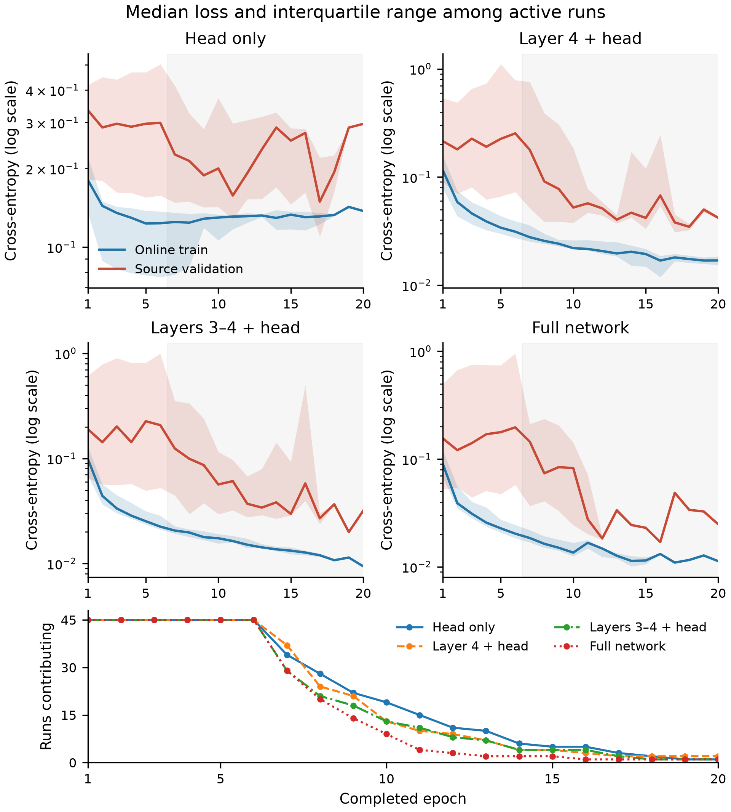

# Experiment setup and common questions

This note first explains the four training scopes we compare, how patients are split, and how the models are trained and tested. It then explains two questions: whether models trained on A have a higher AUC on C than on A, and whether the training records show that the models have been trained enough.

[Back to the results report organized around the proposal](Camelyon17_Results_for_Group_EN.md)

## 1. What did we compare? How did training and testing work?

We use **ResNet-50 pretrained on ImageNet** to decide whether the central region of a small tissue image contains a tumour. We compare four training scopes: Head only, Head + last 3 blocks, Head + last 9 blocks, and Whole network. The data contains **455,954 small images from 43 patients, 50 slides, and 5 hospitals**. In the report, A–E stand for these five hospitals, corresponding to hospital IDs 0–4 in the data.

### How are all the patients and images split?

We first **group images by patient** within each hospital, keeping all images from the same patient together. Within one split, a patient can belong to only one of the training, validation, or test sets. A patient cannot appear in more than one set. All three splits were checked: no patients or slides were shared across sets.

The table below shows the total number of patients at each hospital and the number of patients in each set within one split.

| Hospital | Total patients | Training patients | Validation patients | Test patients |
|---|---:|---:|---:|---:|
| A | 7 | 4 | 1 | 2 |
| B | 8 | 5 | 2 | 1 |
| C | 9 | 5 | 2 | 2 |
| D | 10 | 6 | 2 | 2 |
| E | 9 | 5 | 2 | 2 |

The split is approximately **60% / 20% / 20% of the patients**, rounded to whole patients. It does not split the number of images into 60% / 20% / 20%, because the number of images varies greatly between patients.

All patients and all images in the exported data were assigned to these three sets. **“Using the full data” means that all data was assigned to a set. In each run, only images from the training patients at the training hospital are actually used to update the model parameters.** Images from validation and test patients are not used to update parameters. [Image counts and tumour proportions in each set](data/patient_and_image_counts.csv).

### What happens when A is the training hospital?

1. **Train on images from A's training patients.** The model learns and updates its parameters here.
2. **After each training epoch, calculate the loss on images from A's validation patients.** Validation images do not update the parameters. We save the model from the epoch with the lowest validation loss.
3. **Use the saved model to test images from the test patients at A, B, C, D, and E separately.** We only change the test images for the same model; there is no further training. Test scores are not used to decide which epoch to save.

Testing on A is called **IN, also called ID**: the hospital is the same, but the patients are new patients who did not take part in training. Testing on B–E is called **OUT, also called OOD**: both the hospital and the test patients change. **IN and OUT are both test-set scores. IN is not a training-set score.**

We then repeat this process with B, C, D, and E as the training hospital in turn. Each run starts again from the original ImageNet pretrained weights. We do not take a model trained on A and continue training it on B or C.

### Which parameters does each training scope update?

The four settings below only change which parts of the network are allowed to update.

| Setting | Which parts can learn and update their parameters? |
|---|---|
| Head only | Train only the final classification layer that decides “tumour / no tumour.” Freeze all the feature extraction layers before it. |
| Head + last 3 blocks | The classification head and `layer4`. |
| Head + last 9 blocks | The classification head, `layer3`, and `layer4`. |
| Whole network | All parts. |

In the code, `layer4` contains the last 3 residual blocks, and `layer3` and `layer4` together contain the last 9 residual blocks. Both settings also train the classification head. The proposal says the last 1 / 2 blocks, which differs from the actual experimental scopes. This report describes the experiments that were actually completed, as shown in the table above.

### Why change the patient lists and repeat training?

We use split seeds 42, 43, and 44 to create **three different sets of patient lists**, to check whether the results depend on a particular patient split. After fixing each set of lists, we **train each setting three times**, using training seeds 42, 43, and 44, to check changes caused by training randomness. The training seed changes the initial parameters of the new classification head, the order of the images, and the random flips and rotations. It does not change that set of patient lists.

The total is therefore:

**5 training hospitals × 4 training scopes × 3 sets of patient lists × 3 training seeds = 180 models.**

Each model is tested once on each of the five hospitals, giving **900 test results**. The three sets of lists are different ways to split the same patients, rather than three new groups of patients.

The training settings are the same throughout: 96×96 images; random flips and rotations during training; image preprocessing with the ImageNet mean and standard deviation; the AdamW optimizer; 128 images per batch; a learning rate of 0.001 for the classification head and 0.0001 for the backbone parts allowed to update; weight decay of 0.0001; and cross-entropy loss without class weights. The learning rate is not gradually adjusted during training. BatchNorm statistics in the frozen parts are also fixed, while those in the unfrozen parts update normally.

## 2. For models trained on A, can AUC be higher on C than on A?

Here we compare **the same models trained on A, tested separately on A's test patients and C's test patients**. This is not a comparison between “models trained on A” and “models trained on C.” The table below fixes the training scope to “Head + last 3 blocks.” Each score is the average over three sets of patient lists, with three training runs for each set.

| Test hospital: the same models trained on A | AUC | Accuracy | Loss |
|---|---:|---:|---:|
| A | 0.9309 | **91.76%** | **0.3179** |
| C | **0.9680** | 83.97% | 0.6342 |

**In the table of averages above, C has a higher AUC, but lower accuracy and higher loss.** To check whether this happens every time, we need to compare the models individually, rather than only looking at the averages. In each of the nine comparisons in each row below, we keep the same model trained on A and test it on A and C separately.

| Training scope of the A models | C has higher AUC | C has lower accuracy | C has higher loss |
|---|---:|---:|---:|
| Head only | 4/9 | 9/9 | 9/9 |
| Head + last 3 blocks | 9/9 | 9/9 | 9/9 |
| Head + last 9 blocks | 6/9 | 9/9 | 9/9 |
| Whole network | 3/9 | 9/9 | 9/9 |

The second row shows that all nine models using Head + last 3 blocks have a higher AUC on C. Every row in the two right-hand columns is 9/9. Across the four training scopes, C therefore has lower accuracy and higher loss in 36/36 comparisons.

AUC can be understood this way: randomly take one tumour image and one non-tumour image from the test set, and check whether the model gives the tumour image a higher score. AUC measures the proportion of these pairs in which the tumour image gets a higher score, counting a tie as half. It is not the proportion of images classified correctly using a fixed threshold.

For the specific “Head + last 3 blocks” setting above, the higher AUC on C means that the model is more likely to rank tumour images above non-tumour images on C. But when it uses a threshold of 0.5 to decide “tumour / no tumour,” it classifies a smaller proportion of C's images correctly. The higher loss also means larger errors in the predicted probabilities. A higher AUC alone does not mean that every aspect of performance on C is better. To see whether other training scopes also have a higher AUC on C, look at their individual counts in the table above.

This does not require us to reject the proposal. A's test patients did not take part in training. We cannot assume that they must be easier to classify than C's patients simply because they come from the same hospital. The project checks what actually happens when the hospital changes; it does not require every OUT metric to be worse than IN. These results do not yet tell us why C has a higher AUC.

## 3. Was training enough? Were there problems with the patient splits?

### First compare the training records with the planned stopping conditions

We checked how many epochs each run actually trained for, why it stopped, and which epoch's model was saved. Each run stops when one of the following happens: the training hospital's validation loss has not reached a new low for five consecutive epochs, or training reaches 20 epochs. Testing uses the model from the epoch with the lowest validation loss, which is not necessarily the final epoch.

| Check | What actually happened | What does it show? |
|---|---|---|
| Actual training epochs | Each run lasted 6–20 epochs, with a median of 8 epochs and 1,596 epochs in total | Training did not end after only one epoch. |
| Early stopping condition | 176/180 runs reached “no improvement for five consecutive epochs” | Most experiments met the planned stopping condition. |
| Epoch limit | 4/180 runs reached 20 epochs before meeting the condition above | It is still uncertain whether further training could produce a lower validation loss. |
| Epoch with the lowest validation loss | 51/180 runs selected epoch 1 | Training continued after that, but validation loss did not fall below its value at epoch 1. |
| Changes in training and validation | In 180/180 runs, the final training loss was lower than in the first epoch; in 123/180 runs, the final validation loss was higher than in the first epoch | Although the last recorded training loss was lower, the final validation loss was higher than in the first epoch in 123 runs. |

**The planned training is complete, but these records do not prove that every training scope reached its best possible score.** Selecting epoch 1 means that it had the lowest validation loss in that run's records. It does not mean that training lasted only one epoch, or that the model was already good enough before the first epoch began.

[Records of all 180 training runs](data/training_audit.csv). The figure marks how many experiments were still training at each epoch. Fewer experiments contribute to the statistics at later epochs because the other experiments had already stopped.

These observations make it worth checking for overfitting or problems with the training settings, but they **do not directly prove that the learning rate was too high**. We did not compare different learning rates, and we did not run validation before epoch 1 or partway through an epoch.

Also, training loss is recorded while random image transformations are applied and parameters are updated. Validation loss is calculated after an epoch, using fixed images. A low training loss alone cannot tell us whether training is already good enough.

### Then consider how patient counts and class proportions affect the scores

**Splitting by patient prevents the same patient from appearing in both training and testing, but it does not increase the number of independent patients.** A has only one validation patient per split, and B has only one test patient. Class proportions also vary greatly: tumour images make up **0.53%, 70.66%, and 41.67%** of A's test images in the three splits.

These splits were fixed before the experiments. They were not selected after seeing which split gave better scores. They also do not force a balance between the tumour and non-tumour classes.

To check whether class proportions can make accuracy misleading, we made a reference comparison: after seeing which class was more common in each test set, predict that class for every image. Averaged across the same 20 cross-hospital tasks used for the model scores, this reference gets **82.44%** accuracy. Among the four training scopes, “Head + last 3 blocks” has the highest average cross-hospital accuracy, at **82.40%**.

This reference uses the test labels, so it cannot be treated as a model that could be chosen blindly before deployment. What it reminds us is: **“82% accuracy” alone is not enough. We also need to look at how well each class is recognised. Balanced accuracy gives equal weight to the recognition rates for tumour and non-tumour images and averages them. Section 7 of the main report compares the four scopes.** [Full metrics and class counts](data/evaluations.csv).
